# lumo-watch

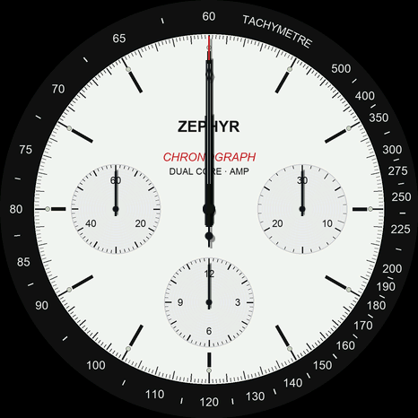

This started as a desk widget. A round AMOLED dev board had been sitting in a drawer long enough to feel guilty about, so I put a clock on it. The clock turned into a watch, the watch turned into an argument with a 16.7 ms deadline, and the argument turned into a volume knob. Here is the whole slide, with the receipts.

## The board

Waveshare **ESP32-S3-Touch-AMOLED-1.75**. A 1.75" round AMOLED, 466x466, driven by a CO5300 over a four-wire QSPI bus at 80 MHz. Capacitive touch. An ESP32-S3 with two cores at 240 MHz, 512 KB of SRAM and 8 MB of PSRAM. Power management, an RTC with no battery to back it, an IMU, two audio codecs that mind their own business, a TF-card slot, and one USB-C port that turns out to have opinions.

One number ran the whole project: a full frame is 434 KB, about **11 ms of bus time**. Redrawing the screen 60 times a second is therefore not a plan, it is a wish. Everything below is what you do instead.

Board support, drivers, apps: [`boards/`](boards/) · [`drivers/`](drivers/) · [`apps/`](apps/) · how to build it: [`docs/BUILD.md`](docs/BUILD.md)

## A simple watch first

Two cores, so two jobs. Core 0 gets the sensors, the buttons, the time and the USB port. Core 1 gets the display and nothing else, like a chef who is not allowed to answer the phone. They pass notes through the chip's mailbox.

The first face used a GUI library. It ran at 12 to 26 fps depending on where the hands happened to point, and the second hand hopped from pixel to pixel like it was crossing a hot pavement. Eight steps later it glides at 59:

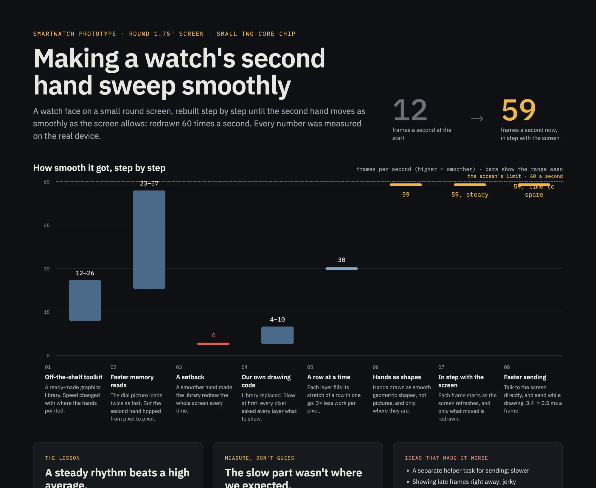

## Making it glide

**Redraw only what moved.** The compositor keeps a list of dirty 8-row bands. A quiet chronograph is ten small bands a frame; the GMT's second hand is a staircase across the dial.

| 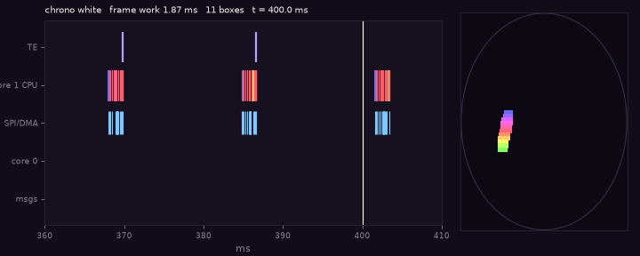 |  |
|---|---|

**Start every frame when the panel does.** The display has a tearing-effect pulse that says "refreshing now". Ignore it and the loop spins thousands of empty frames a second and repaints at random moments mid-refresh. Listen to it and every frame lands in the same place.

| 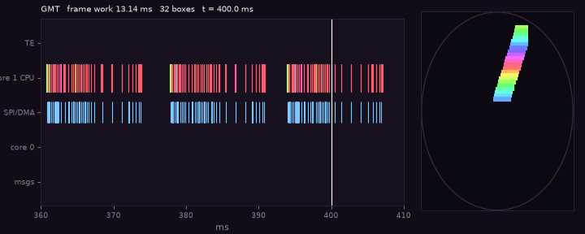 |  |
|---|---|

**Stop asking the driver politely.** Every band went through three SPI driver transactions, each setting up the DMA from scratch: about 100 µs of ceremony, 35 times a frame. Driving the SPI peripheral's own command and address phases from the registers, with two band buffers so the DMA ships one while the CPU draws the next, took display writes from 3.4 ms to 0.5 ms. The red in the clips is the CPU standing around waiting for the DMA.

| 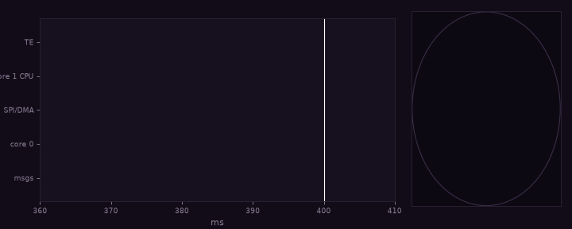 | 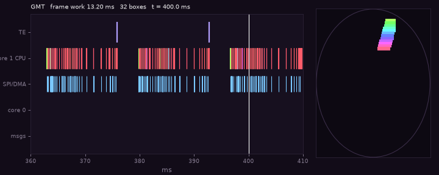 |
|---|---|
| 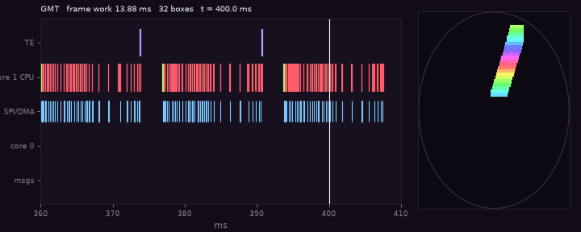 |  |

**Draw hands as maths, not pictures.** Bars, triangles and discs with analytic anti-aliasing; no square roots were harmed. And the bezel, which has to turn, became a polar lookup table: pre-blended so every entry is opaque, squeezed into 256 colours so it fits in the chip's fast memory, and rotated by adding a number to an index.

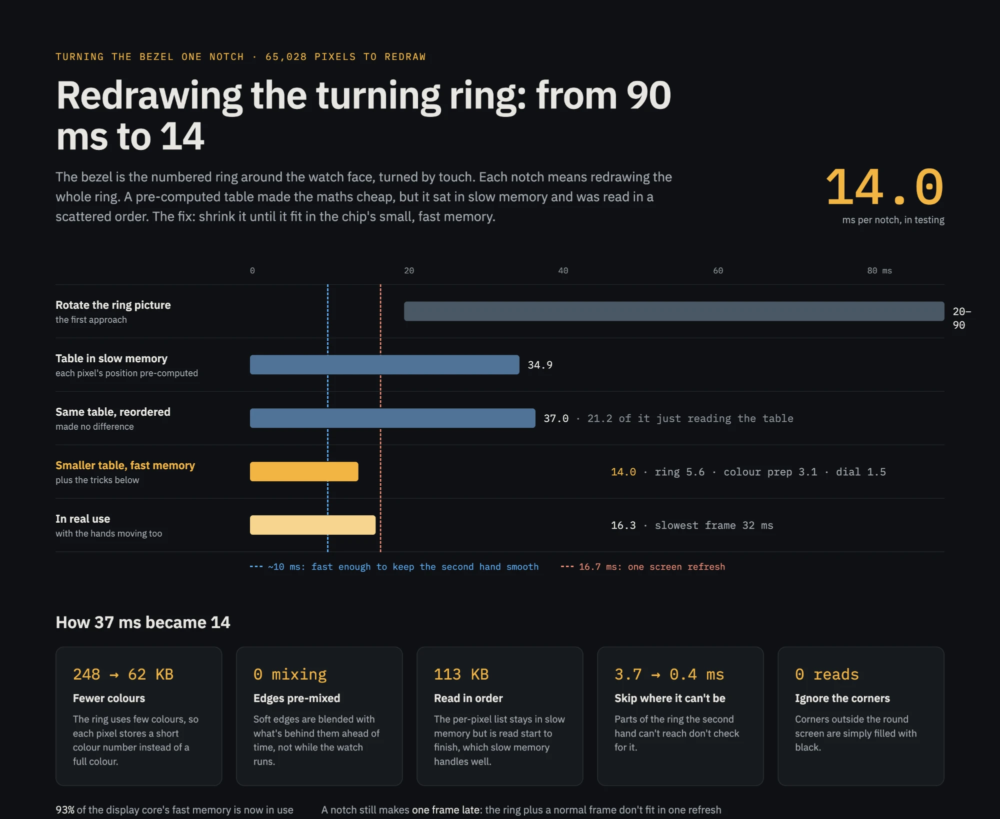

| 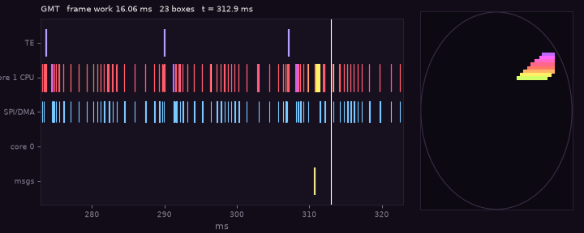 | 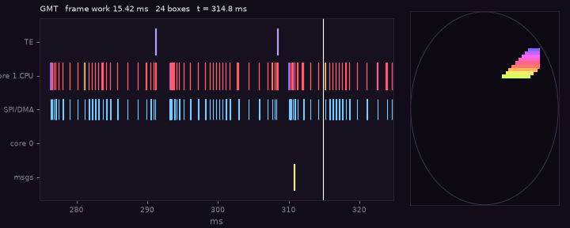 |
|---|---|

**Where it landed:** 59-60 fps, locked to the panel, using 9-13 ms of each 16.7 ms frame. Every "before" above is a real build with that one change switched back off, traced on the same scripted scenario, because "it felt faster" is not a measurement.

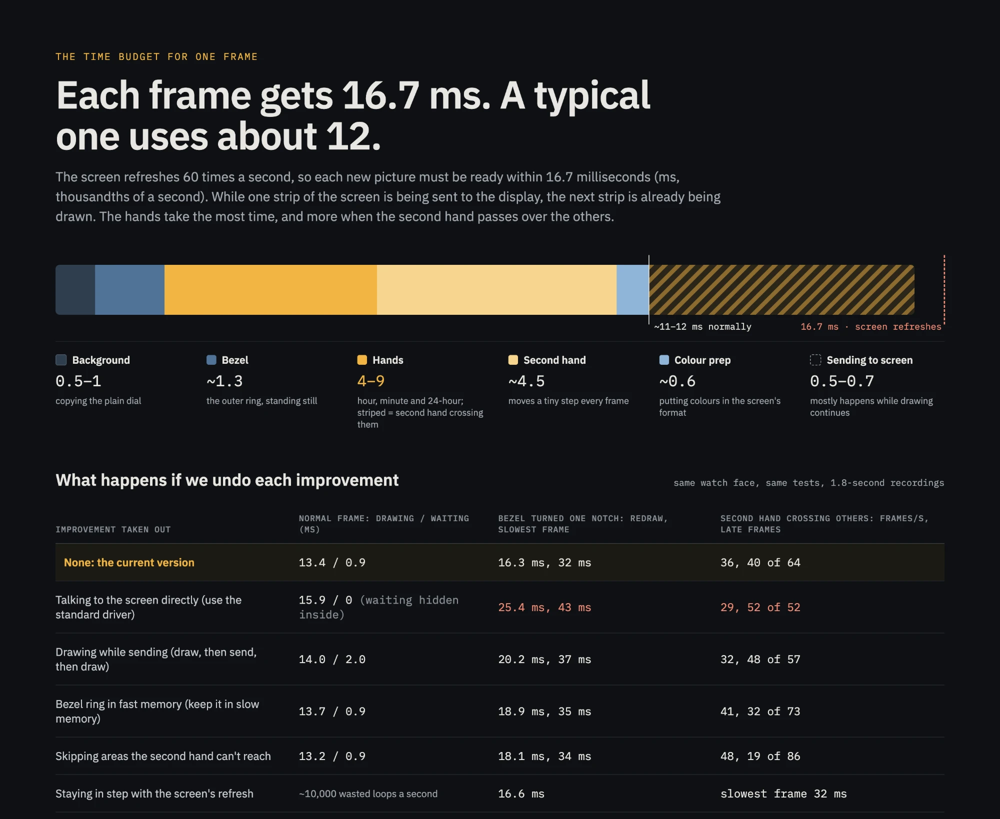

The one dip left: when the second hand sweeps over the other hands, shading them costs up to 10 ms, and a few frames a minute arrive late. The fix is known. It is also next.

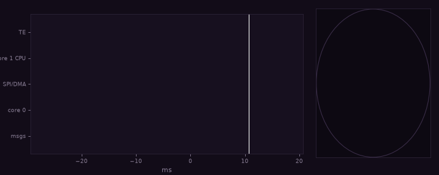

Every step with its numbers: [`docs/optimization-log.md`](docs/optimization-log.md) · all 21 traces, playable: [`docs/data/traces/`](docs/data/traces/README.md)

## A nicer human interface

|  |  | 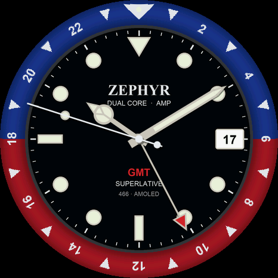 |
|---|---|---|

The bezel turns under your finger and clicks every minute, which is deeply satisfying for no good reason. Two chronographs, black and white: PWR starts and stops, BOOT resets. Hold BOOT for the face picker. Hold two fingers on the glass and the watch stops being a watch.

## Volume, play, skip

Plug it into a laptop and it is a USB media device, the same kind as the volume keys on a keyboard, so Windows and macOS need no driver and ask no questions. The ring is a knob: one key per 15 degrees, a couple of turns from silent to full, like a wheel from a music player you may remember. Mute, previous, next, play/pause, brightness. A small helper on the laptop sends back the real volume, mute and play state and what is playing, which the watch shows as a level meter and a scrolling title. [`apps/watch/src/usb_hid.c`](apps/watch/src/usb_hid.c) · [`tools/agent/agent_mac.py`](tools/agent/agent_mac.py)

Things the USB port had opinions about: it shares one PHY between the flashing port and our device, so once the watch was a USB device you could no longer flash it (a reboot-to-download command fixed that). A keyboard interface for the brightness keys made macOS open "identify your keyboard" on every plug-in. The inter-core mailbox does not queue, so the "open the remote" gesture kept being overwritten by the touch update sent microseconds later. And it holds 512 bytes, so the now-playing text travels in pieces.

## Seeing it: traces, renders, diagrams

Averages lie. Both cores now carry an event tracer (8-byte events on one shared hardware clock), dumped over USB and turned into pages you can play and scrub; the viewer at the top of this page is one. The display code also compiles for the computer, which is where every render on this page came from, pixel for pixel.

[`tools/trace/`](tools/trace/README.md) · [`tools/render/`](tools/render/) · [`docs/diagrams/`](docs/diagrams/) (the diagram prompts) · [`docs/figures/`](docs/figures/)

## Next

A BLE companion app so the helper can retire. Wi-Fi for now-playing from the network. An ambient visualiser for when nobody is touching it. Remembering which face you chose, which it currently forgets with great consistency. [`docs/ideas.md`](docs/ideas.md)

## Links

- Source: this repository (Apache-2.0) · [building and flashing](docs/BUILD.md)
- Numbers: [`docs/optimization-log.md`](docs/optimization-log.md) · raw captures: [`docs/data/`](docs/data/)
